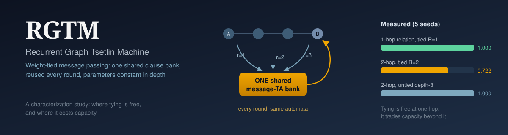

<div align="center">



# RGTM: Recurrent Graph Tsetlin Machine

[](https://github.com/AnwarDebes/RGTM/releases)
[](https://www.python.org/)
[](LICENSE)
[](tests/test_rgtm.py)
[](PAPER.md)

</div>

**Weight-tied recurrent message passing for the Graph Tsetlin Machine.** A Graph
Tsetlin Machine passes messages between neighbouring nodes for `D-1` rounds and
gives every round its own bank of Tsetlin automata, so the automata count grows
linearly with depth. RGTM reuses one shared message-automata bank across all `R`
rounds, so the message-passing parameter count is independent of depth. It is an
alpha research prototype built on the canonical
[`cair/GraphTsetlinMachine`](https://github.com/cair/GraphTsetlinMachine)
(University of Agder, UiA), and it reports where tying helps and where it does
not: one shared bank solves a 1-hop relation perfectly, but falls behind untied
per-round banks on a 2-hop task ([results](#results)).

▶ See this project in the film *Show Its Work*: https://youtu.be/pefnyZ-oCcM?t=1727

## Honest status (alpha)

```
+-------------------------------------------------------------------+
| Implementation: complete; RGTM(R=1) == cair GraphTM(depth=2)      |
|                 (correctness oracle: learns 2-node equality;      |
|                  R=0 is at chance, as it cannot compare nodes).    |
| Training:       canonical cair single-feedback per sample, with   |
|                 the message updates folded onto ONE shared bank.   |
| Negative results (reproduced, see PAPER.md §3 and scratch/diag*): |
|   * node-symbol re-encoding recurrence -> Type II "poison"        |
|     literals -> clauses die -> constant output. (Same mechanism   |
|     behind HGTM's encode-as-literals collapse.)                   |
|   * per-round deep supervision -> corrupts the shared bank.       |
| Relation-detection (A-adjacent-to-B): message round adds real     |
|   capability over single-pass. Multi-seed numbers in results/.    |
| Long-range *relational* propagation: NOT solved by RGTM, and not  |
|   by deep cair GraphTM either (reported as a negative result).    |
| Hardware: validated on Tesla V100 (CUDA 12.9, PyCUDA 2026.1).     |
+-------------------------------------------------------------------+
```

## What RGTM changes vs cair GraphTM

```
cair GraphTM, depth D:   round 0 (node TA) + (D-1) rounds, each its OWN message TA
                         => message-TA parameters grow linearly with depth

RGTM, rounds R:          round 0 (node TA) + R rounds, ALL sharing ONE message TA
                         => message-TA parameters constant in R; R is free/adaptive
```

`R = 1` uses the shared bank exactly once and is therefore identical to a
single-message-round GraphTM, which serves as the correctness oracle.

## Results

Measured on a Tesla V100, 5 seeds, 1000 clauses, test accuracy as mean ± std.
The tables come from [PAPER.md](PAPER.md) §4.2 and §4.4; every run is in `results/`.

**1-hop relation: is A adjacent to B?** (`results/adjacency_5seed.jsonl`)

| rounds | message-TA banks | test accuracy |
|---|---:|---:|
| 0 (single pass) | 0 | 0.508 ± 0.031 (chance) |
| 1 | 1 | 1.000 ± 0.000 |
| 2 | 1 | 1.000 ± 0.000 |
| 3 | 1 | 1.000 ± 0.000 |

**2-hop relation: is B within 2 hops of A?** (`results/depth_efficiency_k2.jsonl`)

| model | message-TA banks | test accuracy |
|---|---:|---:|
| single pass (depth 1) | 0 | 0.498 ± 0.024 |
| cair GraphTM, depth 3 (untied) | 2 | 1.000 ± 0.000 |
| RGTM, 2 rounds (tied) | 1 | 0.722 ± 0.200 |

One shared bank cannot specialise per hop the way two separate banks can, so
tying does not buy parameter-efficient multi-hop message passing at this budget.
Real-data attempts (MUTAG, NCI1, an LRGB Peptides-func probe) all sit at the
majority baseline, the cair baseline included (PAPER.md §4.5), so there is no
real-data claim either way.

## Install

```bash
pip install GraphTsetlinMachine  # cair's Graph Tsetlin Machine, the upstream dependency
pip install -e .                 # rgtm + numpy, scipy, scikit-learn, numba, pycuda
# CUDA-capable GPU required for fit/predict; torch_geometric only for TUDataset/LRGB loaders
```

Tests (from the repo root):

```bash
pytest tests/    # 6 tests; the 3 fit/predict tests are skipped without a CUDA device
```

## API

```python
from rgtm.recurrent_tm import RecurrentGraphTM

model = RecurrentGraphTM(
    number_of_clauses=1000, T=1500, s=10.0,
    rounds=4,                 # R message rounds, ONE shared message-TA bank
    message_size=64, one_hot_encoding=True,
)
model.fit(graphs, Y, epochs=50)   # graphs: a cair Graphs object
preds = model.predict(graphs)
```

`rgtm.graphs_builder.build_graphs` turns a list of `GraphSpec` into cair `Graphs`
(`experiments/run_adjacency.py` shows the full path from dataset to accuracy).

Datasets: `rgtm.datasets.adjacent_pair` (relation detection),
`rgtm.datasets.within_distance` (k-hop reach, the depth-efficiency test),
`rgtm.datasets.long_range_match` / `parity_on_path` (hard propagation probes),
`rgtm.datasets.tudataset` (MUTAG/NCI1 → cair Graphs),
`rgtm.datasets.lrgb` (Peptides-func).

## Experiments

Run from the repo root after `pip install -e .`. Each script appends one JSON
line per run to `--out` (default `results/<experiment>.jsonl`) and prints a
mean/std summary.

```bash
python experiments/run_adjacency.py         --clauses 1000 --rounds 0 1 2 3 --seeds 41 42 43 44 45
python experiments/run_depth_efficiency.py  --k 2 --clauses 1000 --seeds 41 42 43 44 45
python experiments/run_tudataset.py         --dataset MUTAG --seeds 42 123 456 789 1337
```

`run_lrgb.py` (Peptides-func probe) and `run_match_proof.py` (the failed
re-encoding model from PAPER.md §3) list their flags with `--help`.

## Layout

```
rgtm/
  recurrent_tm.py    RecurrentGraphTM (the model)
  model.py           failed re-encoding recurrence, kept to reproduce §3
  graphs_builder.py  GraphSpec + cair Graphs construction
  datasets/          synthetic probes + TUDataset and LRGB loaders
experiments/         runnable studies, write results/*.jsonl
results/             per-run JSONL behind the PAPER.md tables
scratch/             controlled diagnostics behind the §3 negative results
tests/               pytest suite (6 tests)
PAPER.md             working paper draft
```

## License
MIT. Builds on cair/GraphTsetlinMachine (MIT).
